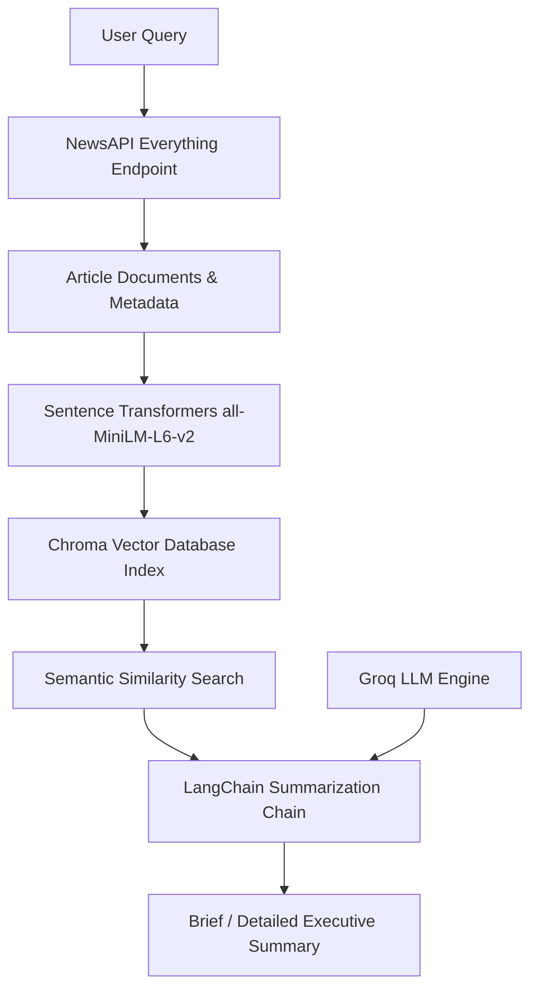

# 📰 News Summarizer RAG (Retrieval-Augmented Generation)

An intelligent, real-time news retrieval and summarization system developed using **LangChain**, **NewsAPI**, **Sentence Transformers**, **Chroma Vector Database**, and **Groq LLMs**.

---

## 🌟 Overview

The **News Summarizer RAG** application enables users to query global news topics in real time, store and index retrieved articles semantically within an in-memory Chroma vector database, and generate tailored, coherent summaries (both brief overviews and detailed executive briefs) powered by Groq-hosted language models.



---

## ✨ Key Features

- **🌐 Live Article Retrieval:** Integrates with the NewsAPI `/everything` endpoint to fetch real-time news across multiple global sources with language filtering and sorting.
- **🧠 Semantic Embeddings:** Employs HuggingFace's `sentence-transformers/all-MiniLM-L6-v2` to convert articles into dense semantic vector representations.
- **⚡ Vector Store Indexing:** Indexes documents into a **Chroma Vector Database** for fast, high-accuracy semantic similarity matching.
- **📝 Multi-tier Summarization:**
  - **Brief Summary:** Quick, high-impact bulleted summary of key headlines and developments.
  - **Detailed Executive Summary:** In-depth synthesis covering background context, current events, and implications.
- **📜 Query & Topic Tracking:** Keeps track of search history and user-selected topics of interest.

---

## 🛠️ Tech Stack

| Component | Technology |
|---|---|
| **Orchestration Framework** | [LangChain](https://www.langchain.com/) |
| **LLM Inference Engine** | [Groq](https://groq.com/) (LLaMA-3.3-70B / Kimi K2) |
| **Embeddings Model** | HuggingFace `sentence-transformers/all-MiniLM-L6-v2` |
| **Vector Database** | [ChromaDB](https://www.trychroma.com/) |
| **Data Ingestion** | [NewsAPI](https://newsapi.org/) |
| **Language** | Python 3.10+ |

---

## 🚀 Getting Started

### 1. Prerequisites

- Python 3.10 or higher
- A free [NewsAPI Key](https://newsapi.org/register)
- A free [Groq API Key](https://console.groq.com/keys)

### 2. Installation

Clone this repository and install dependencies:

```bash
git clone https://github.com/tasneemibrahim-ai/News-Summarizer-RAG.git
cd News-Summarizer-RAG
pip install -r requirements.txt
```

### 3. Environment Setup

Create a `.env` file in the root folder (or copy from `.env.example`):

```bash
cp .env.example .env
```

Populate `.env` with your API credentials:

```ini
GROQ_API_KEY=gsk_your_groq_api_key_here
NEWS_API_KEY=your_news_api_key_here
```

### 4. Running the Application

Open and run the notebook in Jupyter Notebook or VS Code:

```bash
jupyter notebook news_summarizer_rag.ipynb
```

---

## 📂 Repository Structure

```
News-Summarizer-RAG/
├── news_summarizer_rag.ipynb   # Main RAG implementation and pipeline
├── requirements.txt            # Python dependencies
├── .env.example                # Sample environment configuration template
├── .gitignore                  # Git ignore rules for virtual environments & secrets
└── README.md                   # Comprehensive project documentation
```

---

## 👨‍💻 Author

**Tasneem Ibrahim**  
- GitHub: [@tasneemibrahim-ai](https://github.com/tasneemibrahim-ai)
